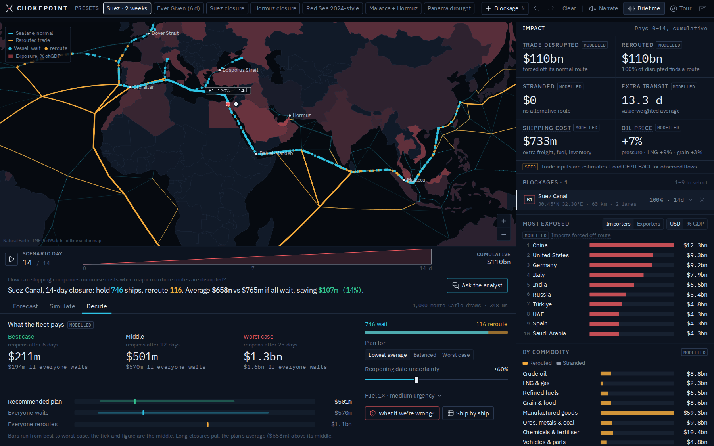
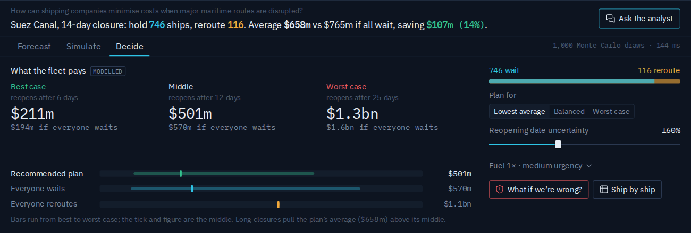
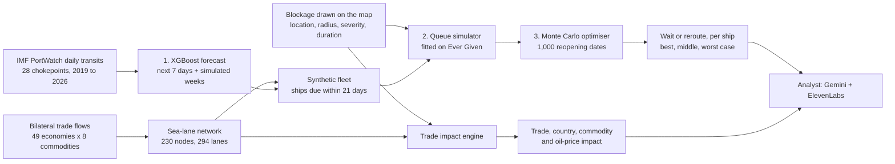
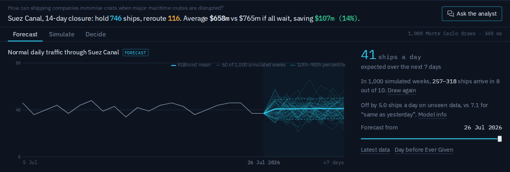
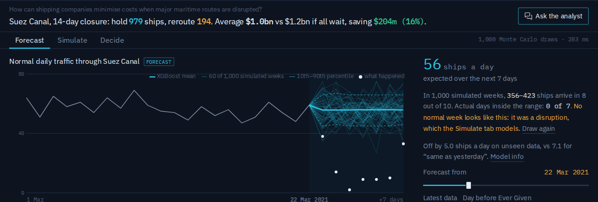
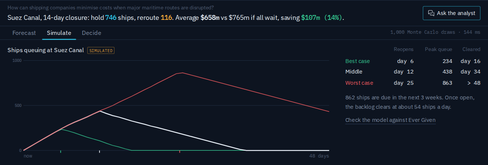
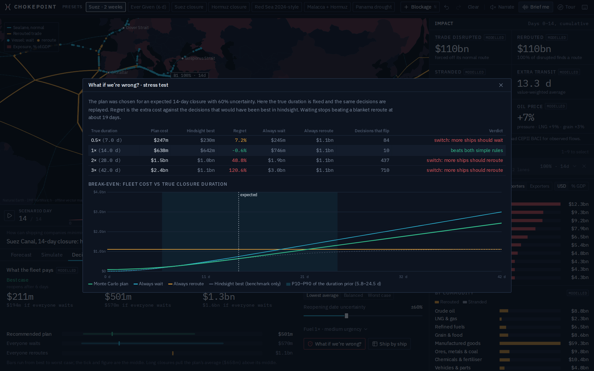
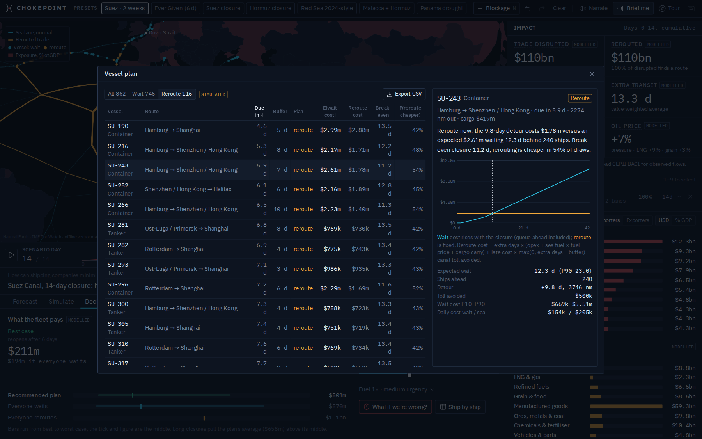
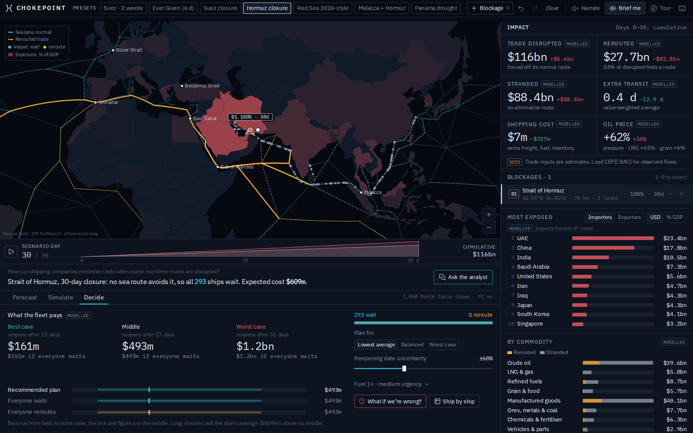

# CHOKEPOINT

**How can shipping companies minimise costs when a major maritime route is disrupted?**

CHOKEPOINT answers that question ship by ship. Drop a blockage anywhere on the world's sea lanes and it:

1. forecasts normal traffic through the affected chokepoint with an XGBoost model trained on observed IMF PortWatch data,
2. simulates the queue the closure creates, using a queue model fitted to the 2021 Ever Given blockage,
3. runs a Monte Carlo optimiser over 1,000 possible reopening dates and tells every ship due in the next three weeks whether to wait or reroute,
4. shows the trade, country, commodity and oil-price impact of the same blockage, and
5. lets an analyst (Gemini, read aloud by ElevenLabs) explain the recommendation using only the model's own numbers.

Built in 25 hours at OxHack 26, Mathematical Institute, Oxford, 24 to 25 October 2026. Entered for the Hudson River Trading track (Best Use of Data for Predictions and Decision Making), MLH Best Use of Gemini API and MLH Best Use of ElevenLabs.

- **Live demo:** [claude.ai/artifact/CSJN2vZy5gBgd4rgnWhqDv](https://claude.ai/artifact/CSJN2vZy5gBgd4rgnWhqDv) (single HTML file, nothing to install)
- **Offline copy of the demo:** [`docs/chokepoint-offline.html`](docs/chokepoint-offline.html)
- **Demo script and judge Q&A:** [`docs/PITCH.md`](docs/PITCH.md)



---

## Contents

- [The answer, in one scenario](#the-answer-in-one-scenario)
- [Why time is the problem](#why-time-is-the-problem)
- [How it works](#how-it-works)
- [Model 1: traffic forecast (XGBoost)](#model-1-traffic-forecast-xgboost)
- [Model 2: disruption simulator](#model-2-disruption-simulator)
- [Model 3: Monte Carlo wait-or-reroute optimiser](#model-3-monte-carlo-wait-or-reroute-optimiser)
- [Trade impact engine](#trade-impact-engine)
- [Analyst mode: Gemini and ElevenLabs](#analyst-mode-gemini-and-elevenlabs)
- [Using the interface](#using-the-interface)
- [Validation](#validation)
- [Performance](#performance)
- [Data sources and provenance](#data-sources-and-provenance)
- [Running it locally](#running-it-locally)
- [Deploying](#deploying)
- [Project structure](#project-structure)
- [Assumptions and limitations](#assumptions-and-limitations)
- [Tech stack](#tech-stack)

---

## The answer, in one scenario

The Suez Canal closes. The expected reopening is in 14 days, but nobody knows exactly when (we model ±60% uncertainty). 862 ships are due at the canal in the next three weeks.

> **Hold 746 ships and reroute 116 around the Cape. Average fleet cost $658m, against $765m if every ship waits: a saving of $107m (14%).**

| Case (percentile of 1,000 draws) | Canal reopens after | Recommended plan | Every ship waits |
|---|---|---|---|
| Best (10th) | 5.8 days | $211m | $194m |
| Middle (50th) | 11.9 days | $501m | $570m |
| Worst (90th) | 24.5 days | $1.33bn | $1.61bn |

If the canal reopens early, the plan costs $17m more than waiting: that is the premium for rerouting 116 ships that turned out not to need it. If the closure drags on, the plan saves $280m. The plan is chosen on one set of 1,000 simulated reopening dates and every figure above is measured on a second, independent set.



---

## Why time is the problem

A ship approaching a blocked canal has two options. Waiting costs money every day: charter or running costs, fuel at anchor, capital tied up in the cargo, and late-delivery costs once its schedule buffer runs out. Rerouting has a fixed cost: extra days at sea burning more fuel, partly offset by the canal toll it no longer pays. Which is cheaper depends on one number nobody knows in advance: **how long the route stays shut**.

The break-even point is different for every ship. A container ship still in Singapore can switch to the Cape route at little extra distance. A tanker already in the Red Sea has to sail back 1,000 nautical miles before it can even start the detour. The ships behind a long queue face a longer wait than the ships at its front. CHOKEPOINT prices all of this under uncertainty and answers per ship.

The data shows how much this matters:

- **Ever Given, March 2021.** PortWatch recorded 59 Suez transits on 22 March and 2 on 25 March. The canal was shut for six days.
- **Red Sea diversions.** Suez averaged 73.5 transits a day from January to October 2023 and about 40 a day through 2025 and 2026. Cape of Good Hope traffic rose to around 90 a day.
- **Strait of Hormuz, 2026.** PortWatch transits fell from about 89 a day in February 2026 to about 5 a day in March 2026.

---

## How it works



All models run in the browser. Python is used only offline, to build the datasets and train the forecaster. When you drag a blockage, the trade engine recomputes in about 25 ms, and the decision engine (forecast, fleet, queue and Monte Carlo) reruns in about 150 ms once you let go.

---

## Model 1: traffic forecast (XGBoost)

**What it predicts.** The number of ships that would transit a chokepoint on each of the next 7 days if nothing were wrong. This is the arrival stream the simulator and optimiser work from.

**Data.** IMF PortWatch daily transit counts, derived from satellite AIS, for all 28 chokepoints PortWatch tracks: 1 January 2019 to 26 July 2026 (2,764 days), split by vessel type. Three missing days were linearly interpolated.

**Model design.**

- **One model for every chokepoint and horizon.** The horizon (1 to 7 days) is an input feature, and the target is transits divided by the chokepoint's 28-day mean. One model therefore serves Malacca (218 ships a day) and Panama (32) alike, and learns from all 28 chokepoints at once: 375,928 training rows covering COVID in 2020, Ever Given in 2021, the 2023 Panama drought and the Red Sea diversions.
- **Features (26).** Daily lags 0 to 13, 20 and 27; the same weekday one and two weeks earlier; 3- and 7-day means; the 28-day/91-day trend; 7-day volatility and minimum; a Poisson z-score of the recent level shift, (MA7 − MA28) / √(MA28 / 7); weekday; horizon. Calendar-month and cargo-mix features were tried and removed because they raised validation error.
- **Time-based split, never shuffled.** Train April 2019 to June 2024. Validation July to December 2024, used for early stopping (114 trees, depth 5, learning rate 0.03) and interval calibration. Test January 2025 to July 2026, untouched during fitting.
- **Prediction intervals.** Split-conformal intervals on residuals scaled by √ŷ, calibrated separately for each chokepoint and horizon. Daily counts behave like Poisson counts, so their spread grows with the square root of the level.
- **Runs in the browser.** The trained trees are exported to JSON and evaluated by a small TypeScript tree walker that compares in float32, as XGBoost does. It matches Python XGBoost to within 0.00008 ships a day across 108 test cases. A hundred 7-day forecasts take 8 ms, so you can move the forecast origin to any day since 2019 and watch it recompute.

**Results on the held-out test period** (mean absolute error, ships per day; lower is better):

| Chokepoint | XGBoost | 28-day mean | 7-day mean | Same day last week | Yesterday | Poisson floor | 80% / 95% interval coverage |
|---|---|---|---|---|---|---|---|
| Suez Canal | **5.04** | 5.04 | 5.36 | 6.99 | 7.13 | 4.98 | 83% / 95% |
| Bab el-Mandeb | **5.20** | 5.21 | 5.53 | 7.40 | 7.17 | 4.63 | 74% / 95% |
| Strait of Hormuz | 15.36 | 17.05 | **15.01** | 19.07 | 17.27 | 6.17 | 77% / 91% |
| Strait of Malacca | 12.70 | **12.69** | 13.16 | 17.68 | 17.29 | 12.11 | 84% / 96% |
| Panama Canal | **2.72** | 2.78 | 2.95 | 3.68 | 3.50 | 4.48 | 83% / 96% |
| Cape of Good Hope | **12.33** | 12.38 | 12.91 | 16.92 | 17.38 | 7.55 | 89% / 100% |
| Strait of Gibraltar | **11.94** | 12.09 | 12.71 | 16.49 | 16.61 | 9.23 | 72% / 91% |
| Bosporus | **12.73** | 12.79 | 13.49 | 17.38 | 17.26 | 7.48 | 68% / 93% |
| Dover Strait | **15.54** | 15.64 | 16.52 | 19.50 | 21.08 | 10.46 | 74% / 90% |

On Suez, XGBoost is 29% more accurate than "same as yesterday" and sits almost exactly on the **Poisson noise floor** (5.04 against 4.98). The residuals have a dispersion index of 0.98, so day-to-day traffic is statistically indistinguishable from random arrivals around the level. No model can forecast that randomness. Instead of pretending to, we carry it forward into the simulation. XGBoost is the best or within 0.02 of the best at eight of the nine chokepoints. The exception is Hormuz, where the test period contains the 2026 collapse.

**Known weakness: abrupt regime shifts.** When traffic changes overnight, a model of normal traffic lags:

| Window | XGBoost | 28-day mean | 7-day mean | Yesterday |
|---|---|---|---|---|
| Suez, Red Sea diversion onset (Dec 2023 to Feb 2024) | 9.13 | 9.43 | 6.97 | 7.97 |
| Cape, Red Sea diversion onset (Dec 2023 to Feb 2024) | 11.41 | 11.52 | 9.81 | 11.95 |
| Hormuz, 2026 collapse (Feb to Jul 2026) | 10.88 | 16.70 | 10.01 | 8.15 |

XGBoost beats the 28-day mean in every window but trails "use yesterday's value". Disruptions are the simulator's job, not the forecaster's.

**Monte Carlo of the forecast.** The Forecast tab draws 1,000 simulated weeks of traffic. Each simulated week gets one shared level shock (so a busy week stays busy) and then Poisson day-to-day noise around the XGBoost mean. The shock's size is set so the simulated spread matches the validated conformal interval: σ² = ((q₈₀ / 1.2816)² − 1) / λ on the log scale. On held-out 2025–26 data, 85% of actual Suez days fall inside the simulated 10th to 90th percentile band (80% would be exact). Rewind the forecast to the day before Ever Given and none of the 7 actual days falls inside the simulated range: no normal week looks like a blockage.




---

## Model 2: disruption simulator

**Model.** A first-in, first-out queue at the chokepoint. While closed, the chokepoint serves (1 − severity) × κ × L ships a day, where L is the normal 28-day level. After reopening it clears the backlog at κ × L ships a day. Arrivals come from the forecast. The same queue runs at the aggregate level (daily transits and queue length) and at the vessel level inside the optimiser.

**Calibration on a real closure.** We fitted κ by least squares to the PortWatch daily transits for 23 March to 10 April 2021, using the XGBoost forecast made on 22 March as the arrival stream:

| Parameter | Fitted value | Meaning |
|---|---|---|
| κ | 1.31 | Backlog clears at 1.31 times the normal daily level |
| Capacity during closure | 14% | Transits that continued while the canal was blocked |
| Diverted arrivals | 16% | Ships that did not join the queue |
| Error | 9.6 ships/day | Against 17.9 for the same model without a catch-up surge |

For the two-week Suez scenario, the queue peaks at 234, 438 and 863 ships in the best, middle and worst case, and is cleared by day 16, day 34 and after more than 48 days respectively.



---

## Model 3: Monte Carlo wait-or-reroute optimiser

**The fleet.** 862 synthetic ships due at Suez within 21 days, built from the data rather than invented:

- the **daily count** comes from the forecast (days 8 to 21 use the forecast's 7-day mean),
- the **vessel classes** (container, tanker, dry bulk, general cargo, ro-ro) follow the mix PortWatch observed at that chokepoint over the previous 28 days,
- each ship's **origin and destination** is drawn from the 16 busiest port pairs through the chokepoint in the trade network, weighted by the cargo that class carries,
- **cargo values** come from the trade model's per-ship cargo table, and **schedule buffers** depend on the cargo-urgency setting.

**Costs.** For ship *i*, with queue delay *Wᵢ(T)* when the closure lasts *T* days:

```
wait cost     = W(T) × (opex + anchor fuel × fuel price + cargo carry)
              + late cost per day × max(0, W(T) − schedule buffer)

reroute cost  = extra days × (opex + sea fuel × fuel price + cargo carry)
              + late cost per day × max(0, extra days − schedule buffer)
              − canal toll avoided

extra days    = (best alternative distance from the ship's current position
                 − remaining normal distance) / (speed × 24)
```

The alternative route comes from Dijkstra's algorithm over the network with every blocked lane removed. It is evaluated from each node of the ship's current route, so a ship that has already passed the point where the Cape route splits off pays to sail back. Where no sea route avoids the blockage (Hormuz), rerouting is not offered.

**Uncertainty.** The closure duration T is drawn from a lognormal distribution whose mean is the blockage's duration and whose coefficient of variation is set by the user (default 60%).

**Queue-consistent decisions in one pass.** Under first-in, first-out service a ship's delay depends only on the ships ahead of it. Ships therefore decide in arrival order, and each one sees the queue formed by the decisions of every ship ahead of it, in each of the 1,000 draws. No fixed-point iteration is needed; one pass costs O(ships × draws).

**Decision rule.** A ship waits if a risk measure of its wait-cost distribution is no higher than its reroute cost. The measure is the user's choice: the mean (lowest average cost), CVaR 95% (the mean of the worst 5% of draws), or a 50/50 blend.

**Honest evaluation.** Decisions are made on one set of 1,000 draws and scored on an independent set, with common random numbers across five strategies:

| Strategy | What it does |
|---|---|
| Everyone waits | Every ship queues |
| Everyone reroutes | Every ship with an alternative takes it |
| Point estimate | Same rule, deciding as if the closure lasts exactly its expected duration |
| Monte Carlo plan | The recommendation |
| Perfect foresight | Same rule with the true duration known. A benchmark only, never deployable |

**Results** (expected-cost rule, ±60% uncertainty, medium urgency, fuel at $620 a tonne):

| Scenario | Ships | Wait / reroute | Plan, average | Everyone waits | Everyone reroutes | Saving vs best simple rule |
|---|---|---|---|---|---|---|
| Suez, 7 days | 862 | 829 / 33 | $256m | $270m | $1.11bn | $14m (5.4%) |
| Suez, 14 days | 862 | 746 / 116 | $658m | $765m | $1.11bn | $107m (14.0%) |
| Suez, 28 days | 862 | 307 / 555 | $1.04bn | $1.86bn | $1.11bn | $68m (6.2%) |
| Panama, 14 days | 668 | 606 / 62 | $583m | $641m | $1.60bn | $58m (9.0%) |
| Hormuz, 14 days | 293 | 293 / 0 | $218m | $218m | not possible | none: no sea alternative |

The plan beats both simple rules in every scenario that has an alternative route. The best simple rule switches from "wait" to "reroute" as closures lengthen, and the plan beats whichever one is ahead.

**Risk preference** (Suez, 14 days):

| Plan for | Reroute | Average | Worst case (90th) | CVaR 95% |
|---|---|---|---|---|
| Lowest average | 116 | $658m | $1.33bn | $2.13bn |
| Balanced | 508 | $776m | $978m | $1.25bn |
| Worst case | 762 | $1.01bn | $1.04bn | $1.09bn |

A risk-averse operator pays about $350m more on average to cut the CVaR 95% tail from $2.13bn to $1.09bn.

**What the extra information is worth.** For the 14-day Suez scenario, perfect foresight would cost $549m. Knowing the reopening date in advance is therefore worth $110m (the expected value of perfect information). Under the lowest-average rule, deciding on the point estimate is only $5m worse than the full Monte Carlo, because costs are close to linear in duration. Under the balanced rule the gap is $408m: once you care about the tail, the shape of the distribution matters.

**"What if we're wrong?"** The stress test replays the plan as if the closure lasted 0.5, 1, 2 or 3 times the expected duration. It shows the cost against the best decisions in hindsight, how many decisions would flip, and a break-even chart of fleet cost against true duration for each strategy. For the 14-day Suez plan, regret is 7.2% if the canal reopens in half the time and 48.8% if it takes twice as long. That asymmetry is exactly what the worst-case setting is for.



**Per ship.** Every ship gets its expected and 90th-percentile wait cost, reroute cost, detour length, ships ahead in the queue, probability that rerouting is cheaper, a break-even closure duration, a chart of wait cost against closure duration, and a plain-English explanation. The full plan exports to CSV.



---

## Trade impact engine

The right-hand panel shows what the same blockage does to world trade.

- **Network.** 230 nodes (64 ports, 9 chokepoints and ocean waypoints) and 294 sea lanes, each a great-circle leg checked against Natural Earth 1:50m land so none crosses a continent. Port-to-port distances agree with the `searoute` library to within 2 to 5%.
- **Flows.** 49 economies × 8 commodity groups (crude oil, LNG and gas, refined fuels, grain and food, manufactured goods, ores and metals, chemicals and fertiliser, vehicles): 10,721 bilateral flows covering 84% of world goods exports.
- **Mechanics.** A blockage multiplies each lane's capacity by Π(1 − severity), so overlapping blockages compound without double counting. Displaced flows take the shortest path avoiding every affected lane, then any capacity-limited pipeline bypass (Saudi East-West, UAE Habshan–Fujairah, Iran Goreh–Jask); anything left over is stranded. Duration scaling is exact because the timeline is a sum of constant-rate segments.
- **Outputs.** Trade disrupted, rerouted and stranded; value-weighted extra transit days; extra shipping cost; exposure of each country in USD and as a share of GDP (also drawn as the map heatmap); commodity breakdown; oil, LNG and grain price pressure; change in ships a day at every chokepoint. Every headline figure shows its formula on hover.

| Preset | Trade disrupted | Stranded | Extra transit | Shipping cost | Oil | Most exposed importer | Biggest traffic shift |
|---|---|---|---|---|---|---|---|
| Suez, 2 weeks | $110.5bn | $0.0bn | 13.3 d | $0.7bn | +7% | China $12.3bn | Cape of Good Hope +129% |
| Ever Given (6 days) | $47.3bn | $0.0bn | 13.3 d | $0.3bn | +4% | China $5.3bn | Cape of Good Hope +129% |
| Suez, 30 days | $236.7bn | $0.0bn | 13.3 d | $1.6bn | +10% | China $26.4bn | Cape of Good Hope +129% |
| Hormuz, 30 days | $116.1bn | $88.4bn | 0.4 d | $0.0bn | +62% | UAE $23.4bn | n/a |
| Red Sea 2024-style (65%, 120 days) | $609.4bn | $0.0bn | 9.4 d | $4.4bn | +10% | China $71.3bn | Cape of Good Hope +83% |
| Malacca + Hormuz (21 days) | $255.0bn | $86.0bn | 2.0 d | $0.2bn | +67% | China $45.6bn | Panama Canal +21% |



---

## Analyst mode: Gemini and ElevenLabs

"Ask the analyst" opens a panel where you can ask about the current scenario: "Why are these vessels being rerouted?", "What changes if the closure lasts another week?", "Which vessels have the greatest deadline risk?", "How sensitive are the savings to fuel prices?", "What is the worst-case outcome?". "Recommend a decision" gives a spoken summary.

**Grounded by construction.** Gemini never calculates figures itself.

1. The browser sends Gemini a compact, numbers-only summary of the current screen: the forecast, the decision, the five strategies, the best, middle and worst cases, the stress test and the trade impact.
2. Gemini can call five allow-listed, read-only tools: `get_scenario`, `get_vessel`, `list_vessels`, `stress_test`, and `what_if`, which reruns the forecast, simulator and optimiser with changed assumptions without touching the user's screen.
3. The server route (`/api/analyst`) forwards Gemini's tool calls to the browser, which runs them against the live models and returns the results. Gemini then writes the answer. The API key never leaves the server.
4. ElevenLabs (`/api/tts`, with-timestamps endpoint) reads the answer aloud, and the transcript highlights each word as it is spoken.

Without keys, a deterministic built-in analyst answers the suggested questions from the same tools, and the browser's voice reads them. In the standalone demo, the analyst uses Claude through the artifact runtime with the same tools, because a published page cannot reach the Gemini or ElevenLabs APIs.

---

## Using the interface

| Area | What you can do |
|---|---|
| **Map** | Click open water to add a blockage, or a chokepoint dot to close it. Drag to move; drag the white handle to resize. Countries are shaded by exposure as a share of GDP. Ship dots show the plan (cyan waits, amber reroutes); click one for its breakdown. |
| **Timeline** | Play the scenario day by day or scrub to any day. Losses build up and the map and figures follow. |
| **Right panel** | Headline impact (trade disrupted, rerouted, stranded, extra days, shipping cost, oil price), the blockage list with collapsible severity, duration and radius controls, most exposed countries (USD or % of GDP, importers or exporters), commodity breakdown, chokepoint traffic changes and live prices. |
| **Forecast tab** | XGBoost forecast with 1,000 simulated weeks. Move the forecast date back to any day since 2019, or jump to the day before Ever Given. "Model info" opens the full evaluation. |
| **Simulate tab** | Queue length in the best, middle and worst case, and a check of the queue model against the real Ever Given closure. |
| **Decide tab** | Best, middle and worst case costs, range bars against both simple rules, risk preference, reopening uncertainty, fuel price and cargo urgency, "What if we're wrong?" and the ship-by-ship plan. |
| **Analyst** | Questions in plain English, answered from the model and read aloud. |
| **Tour** | A five-step guided tour runs on first visit. Replay it from the top bar. |

Presets: Suez (2 weeks), Ever Given (6 days), Suez (30 days), Hormuz, Red Sea 2024-style, Malacca + Hormuz, Panama drought.

| Key | Action |
|---|---|
| `N` | New blockage at map centre |
| `1`–`9` | Select blockage |
| Arrows | Move selected blockage (Shift: 1°), or pan the map |
| `[` `]` | Severity −/+ 5% (Shift: duration −/+ 5 days) |
| `-` `=` | Radius −/+ 10% |
| Delete | Remove selected blockage |
| Space | Play or pause the timeline |
| Ctrl/⌘ + Z, Shift + Ctrl/⌘ + Z | Undo, redo |
| `?` | Shortcut list |

---

## Validation

`npm run sanity` runs 21 automated checks and exits non-zero if any fails. All pass.

**Forecaster and simulator**
- TypeScript tree inference matches Python XGBoost (108 fixtures, maximum difference 7.7 × 10⁻⁵ ships a day).
- Simulated forecast weeks are calibrated on held-out data (85.1% of 1,323 actual Suez days inside the 80% band).
- The TypeScript queue reproduces the Python Ever Given fit (maximum difference 0.005 ships a day; error 9.6 ships a day against observations).

**Optimiser**
- A longer expected closure produces more reroutes (7 days: 33; 14 days: 112; 28 days: 548).
- The Monte Carlo plan beats both simple rules out of sample for a 14-day closure.
- Perfect foresight is a lower bound on the plan's cost.
- Dearer fuel produces fewer reroutes.
- The worst-case setting lowers CVaR 95%.
- Hormuz has no sea alternative, so every ship waits.

**Trade engine**
- Closing Suez sends China–Netherlands trade around the Cape, adding 10 to 14 days, and Cape traffic rises.
- Closing Hormuz strands most Gulf crude, and China, India, South Korea and Japan are among the hardest-hit non-Gulf energy importers.
- Closing Panama affects less than 3% of Asia–Europe trade.
- Severity 0 and duration 0 give zero impact; doubling the duration exactly doubles disrupted value; severity is monotonic.
- Two blockages on one lane do not double count; two 50% blockages remove 75% of capacity; Malacca and Hormuz together compound.

`npm run decision` prints the optimiser's results for several scenarios.

---

## Performance

Measured in the build sandbox.

| Operation | Time |
|---|---|
| Trade engine start-up (baseline routing of 10,721 flows) | ~160 ms |
| One trade-engine pass while dragging a blockage | ~25 ms |
| 100 XGBoost 7-day forecasts in the browser | 8 ms |
| 1,000 simulated forecast weeks | ~14 ms |
| Full decision engine: forecast, fleet of 862 ships, routing, queue, Monte Carlo (decisions plus independent evaluation of five strategies), stress test | ~150 ms |

The trade engine is throttled to one pass every 90 ms so numbers move while you drag. The decision engine runs 220 ms after you stop.

---

## Data sources and provenance

Every figure in the interface carries a badge: **OBSERVED**, **FORECAST**, **MODELLED**, **SIMULATED** or **SEED**.

| Dataset | Status | Source | Used for |
|---|---|---|---|
| Daily chokepoint transits, 2019-01-01 to 2026-07-26 | OBSERVED | IMF PortWatch (satellite AIS), via a public MIT-licensed mirror (github.com/bopanna012/Global-Supply-Chain-Performance-Dashboard); `fetch_portwatch.py` pulls the latest directly | Forecaster training, chokepoint baselines (Jan–Oct 2023 means), fleet class mix, Ever Given calibration |
| GDP, current USD | OBSERVED | World Bank (Taiwan from the IMF World Economic Outlook) | Exposure as % of GDP |
| Commodity prices | OBSERVED when keyed | FRED: Brent (`DCOILBRENTEU`), Asian LNG (`PNGASJPUSDM`), wheat (`PWHEAMTUSDM`) | Live prices panel |
| Sea-lane network | MODELLED | Built offline, land-checked against Natural Earth, calibrated against `searoute` | All routing |
| Bilateral trade flows | SEED | Gravity-model allocation of approximate 2023 national totals; `build_trade_baci.py` replaces them with CEPII BACI | Trade impact, fleet routes and cargo values |
| Vessel economics | MODELLED | Stated assumptions per vessel class (`lib/models/assumptions.ts`) | Wait and reroute costs |
| Fleet | SIMULATED | Generated from the forecast, the observed class mix and the network's busiest routes | Optimiser |

---

## Running it locally

**Requirements:** Node.js 20 or newer. Python 3.10+ only if you want to rebuild the data or retrain the model.

```bash
npm install
npm run dev                  # http://localhost:3000
```

For a demo, use production mode:

```bash
npm run build && npm start
```

**API keys (optional).** Create `.env.local` from `.env.example`. Everything works without keys; each one switches on a live service. Keys are read only by the server routes in `app/api/` and never reach the browser. `GET /api/status` shows which services are configured.

| Variable | Enables | Without it |
|---|---|---|
| `GEMINI_API_KEY`, `GEMINI_MODEL` (default `gemini-3.8-flash`) | Analyst mode with Gemini function calling; Gemini-written "Brief me" | Built-in analyst and template brief |
| `ELEVENLABS_API_KEY`, `ELEVENLABS_VOICE_ID`, `ELEVENLABS_MODEL_ID` | Spoken answers with word-timed transcript | Browser speech synthesis |
| `FRED_API_KEY` | Live Brent, LNG and wheat prices (cached 10 minutes) | Prices panel hidden |

**Checks**

```bash
npm run typecheck            # TypeScript, strict
npm run sanity               # 21 engine and model checks
npm run decision             # optimiser results for several scenarios
npm run pitch                # trade-engine preset table
```

**Standalone demo** (one HTML file with the app, styles and all data inlined; React 18 and d3 load from cdnjs):

```bash
npm run build:artifact       # writes artifact/dist/chokepoint.html
```

**Rebuilding the data and retraining the forecaster**

```bash
cd data-prep
pip install -r requirements.txt
python fetch_portwatch.py                                  # latest PortWatch daily chokepoint table
python build_traffic.py --csv raw/daily_chokepoints.csv    # -> public/data/traffic.json
python build_portwatch.py --csv raw/portwatch_daily.csv && python build_meta.py
python train_forecast.py                                   # trains, evaluates, exports trees and parity fixtures
python calibrate_queue.py                                  # refits the queue model on Ever Given
cd .. && npm run sanity
```

---

## Deploying

Both options give a public HTTPS link and redeploy automatically when you push to GitHub. API keys are entered on the host, never committed.

**Vultr (one paste).** In the Vultr dashboard choose Deploy, Cloud Compute, Ubuntu 24.04 (2 GB RAM recommended). Under Additional features, tick Cloud-Init User-Data and paste [`deploy/vultr-cloud-init.sh`](deploy/vultr-cloud-init.sh) with your keys filled in at the top. About eight minutes later the app is live at `https://<server-ip-with-dashes>.sslip.io` with a Let's Encrypt certificate from Caddy, so no domain is needed. A systemd timer checks GitHub every two minutes and rebuilds on new commits ([`deploy/update.sh`](deploy/update.sh)). Logs: `/var/log/chokepoint-setup.log` and `journalctl -u chokepoint`.

**Vercel.** Import the GitHub repository at vercel.com/new (the framework is detected as Next.js), add `GEMINI_API_KEY`, `ELEVENLABS_API_KEY` and `FRED_API_KEY` under Environment Variables, and deploy. The model-backed API routes declare `maxDuration = 30` so slower Gemini responses are not cut off.

---

## Project structure

```
app/
  page.tsx, layout.tsx, globals.css, theme.css
  api/analyst/route.ts       Gemini function-calling proxy (key server-side, allow-listed tools)
  api/tts/route.ts           ElevenLabs text-to-speech with word timings
  api/brief/route.ts         spoken scenario brief
  api/prices/route.ts        FRED prices, 10-minute cache
  api/status/route.ts        which services are configured
components/
  App.tsx, TopBar.tsx, Timeline.tsx, Tour.tsx, BriefPanel.tsx
  map/                       MapLibre map: lanes, blockages, heatmap, reroute traces, ship dots
  panel/                     impact headlines, blockages, countries, commodities, chokepoints, prices
  decision/                  Forecast / Simulate / Decide window, model info, stress test, ship-by-ship plan
  analyst/                   analyst panel
lib/
  engine/                    trade impact engine: network routing, blockage effects, scenario timeline
  models/
    forecast.ts              XGBoost inference, conformal intervals, simulated weeks, backtests
    fleet.ts                 synthetic fleet from forecast, observed mix and routes
    queue.ts                 aggregate FIFO queue
    montecarlo.ts            sequential FIFO Monte Carlo optimiser, evaluation, stress test, break-even
    decision.ts              orchestration and best / middle / worst cases
    assumptions.ts           vessel economics, tolls, urgency settings
  analyst/                   context builder, tools, Gemini client loop, built-in analyst
data-prep/
  build_traffic.py           PortWatch -> traffic.json
  forecast_features.py       feature definitions shared with lib/models/forecast.ts
  train_forecast.py          training, evaluation, conformal calibration, tree export
  calibrate_queue.py         Ever Given fit
  build_network.py, build_trade_seed.py, build_trade_baci.py, ...
artifact/                    single-file build: d3 map, Claude analyst backend, build script
deploy/                      one-paste Vultr cloud-init setup and auto-redeploy script
public/data/                 network, flows, countries, traffic, forecast model and evaluation, queue calibration
scripts/                     sanity checks, decision demo, pitch table
docs/                        pitch script, screenshots, offline demo
```

---

## Assumptions and limitations

- **Trade flows are estimates.** The bilateral matrix is a gravity-model allocation of approximate 2023 national totals (SEED) until CEPII BACI is loaded; the script to do so is included. Gulf energy dependence of Japan and South Korea is understated as a result.
- **The fleet is synthetic.** Counts, classes and routes come from data, but individual ships, cargo values, schedule buffers and late-delivery costs are generated from stated assumptions.
- **Vessel economics are typical values,** not quotes: charter-equivalent daily costs, fuel burn at sea and at anchor, canal tolls, cargo carrying cost of 8% a year, fuel at $620 a tonne. All live in one file and can be changed.
- **PortWatch counts are lower than canal-authority figures,** so the fitted catch-up rate (κ = 1.31) is in PortWatch units. The queue model is internally consistent, but published clearance times for Ever Given were faster.
- **The closure-duration distribution is a user input** (lognormal around the blockage's duration). There are too few historical closures to fit it from data.
- **The forecaster predicts normal traffic.** It lags abrupt regime shifts, as the table above shows.
- **Ships decide individually.** Each ship minimises its own cost given the queue ahead of it. A canal-wide planner could also account for the delay a waiting ship imposes on those behind it.
- **Price pressure is a stated elasticity** applied to the share of seaborne supply removed, not a market model.

---

## Tech stack

- **Frontend:** Next.js 15, React 19, TypeScript (strict), Tailwind CSS 4, MapLibre GL, Recharts, Zustand, Lucide icons, IBM Plex Sans and Mono.
- **Models in the browser:** a TypeScript port of the XGBoost trees, seeded PRNG (mulberry32 with Box–Muller), Dijkstra routing over typed arrays, a sequential FIFO Monte Carlo over Float64Arrays.
- **Offline data and training:** Python, pandas, NumPy, XGBoost, shapely, networkx, searoute.
- **Services:** Google Gemini (function calling), ElevenLabs (text-to-speech with timestamps), FRED.
- **Standalone build:** esbuild, the Tailwind CLI and a d3-geo SVG map, packaged as one HTML file.

---

## Team

<!-- Add names and GitHub handles -->
Built at OxHack 26 by a team of four second- and third-year computer science and data science students.

Data: IMF PortWatch, World Bank, FRED, Natural Earth. PortWatch history retrieved through the public mirror at github.com/bopanna012/Global-Supply-Chain-Performance-Dashboard (MIT licence).

All scenarios are hypothetical. Figures are model estimates from the stated assumptions and do not describe a current event.
